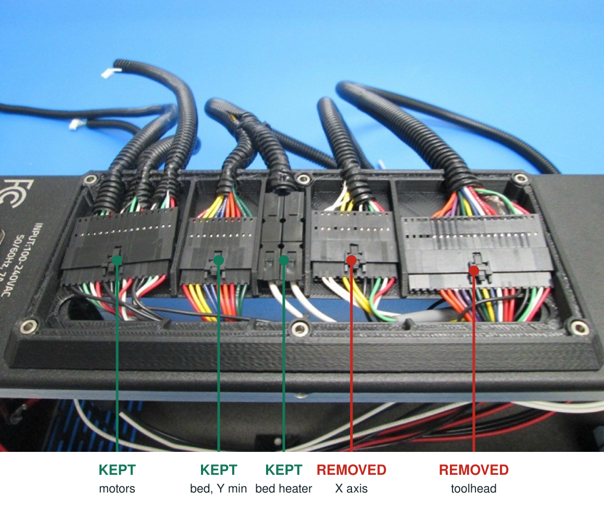
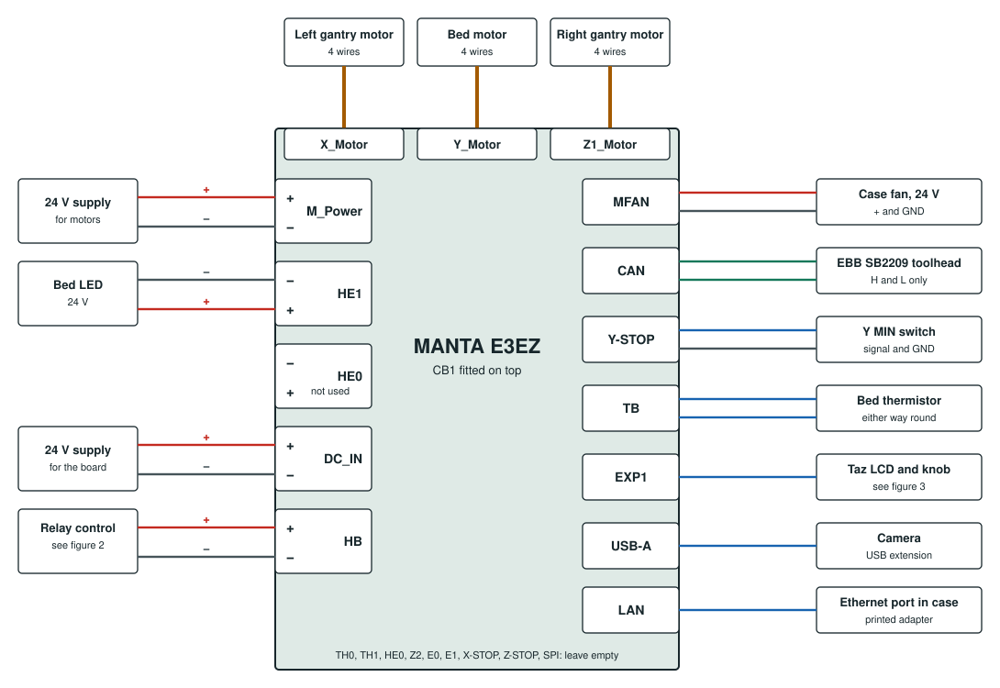
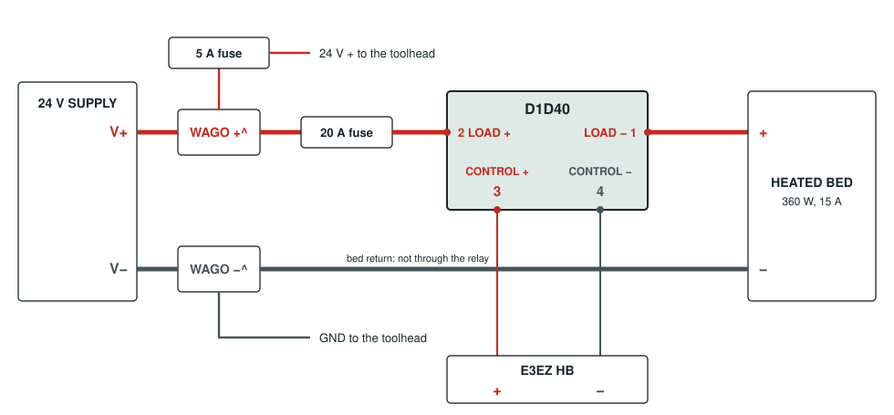
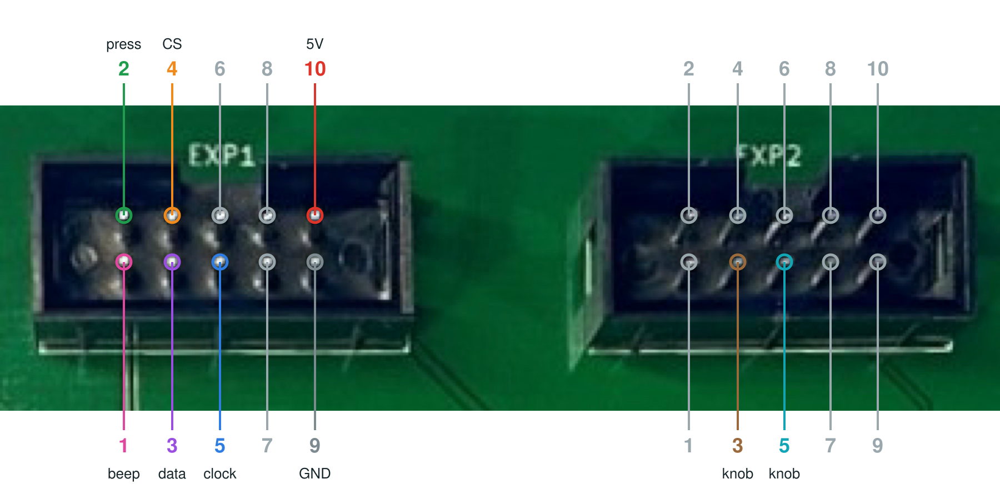
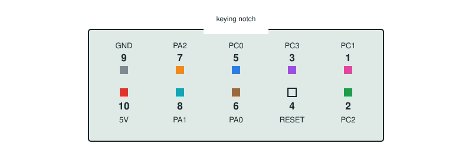
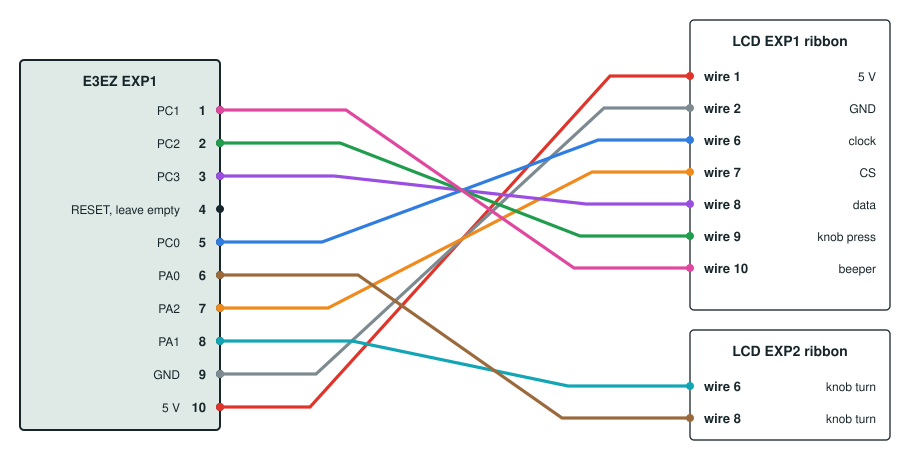
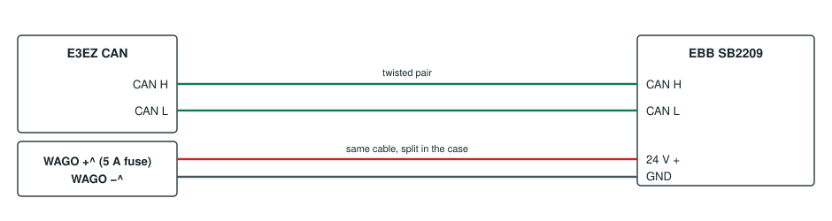

# Manta Board: BIGTREETECH Manta E3EZ wiring (draft)

> [!CAUTION]
> **Untested draft. Nothing here has been powered on yet.** The LCD pinout was worked out from a photo of one board
> and has not been confirmed with a meter. Wrong wiring can destroy electronics, and the 15 A bed circuit can start a
> fire. Verify every connection on your own printer. Use at your own risk.

**^ marks a guess that still has to be confirmed.**

## What this conversion does

The TAZ 6 started with a RAMBo board, which failed. It was then fitted with an Archim2 from a conversion kit. Now a
BIGTREETECH Manta E3EZ V1.0 takes that place, with a CB1 running Klipper on the same board. No kit exists for this one, so
the adapters are home-made. The toolhead becomes a Stealthburner with its own BTT EBB SB2209 board.

On the stock printer every toolhead wire runs back to the control box. Here the extruder motor, hotend, fans, probe and X
endstop connect to the EBB on the toolhead, and only 24 V power and a CAN pair (H and L) run back. That is why the
toolhead harnesses disappear. Mains wiring is not covered. Work with the printer unplugged.

| | Stock | Here |
|---|---|---|
| Mainboard | RAMBo | Manta E3EZ + CB1 |
| Toolhead wiring | Individual wires to the control box | 24 V + CAN to the EBB |
| X endstop and probe | Control box | EBB |
| Z homing | Z min switch / probe | Probe on the toolhead |
| Heated bed | Switched by the RAMBo | Switched by a separate DC relay |
| LCD | Two ribbons to two headers | Rewired into one header |
| Network | None | Ethernet port in the case |

## What stays and what goes

*Photo: Aleph Objects, Inc. (LulzBot), TAZ 6 control box assembly guide, step 31, CC BY-SA 4.0. Labels added.*

Looking at the open connector bay, left to right:

| Connector | Stock use | Here |
|---|---|---|
| 1st, 16-pin | Motors (EL-HR0088) | **Kept** |
| 2nd, 10-pin | Bed and endstops (EL-HR0081) | **Kept**: bed thermistor and Y min only |
| Middle, Anderson | Bed heater power | **Kept**, now fed through the relay |
| 4th, 12-pin | X axis (EL-HR0084) | **Removed** |
| 5th, 20-pin | Toolhead (EL-HR0087) | **Removed** |

- The CAN cable and the camera's USB cable come through the freed openings.
- The second-extruder connector is also removed. A 3D-printed adapter there holds an Ethernet port, wired to the E3EZ.

## Jump harnesses to build

The stock harnesses are **not cut**. Each adapter has the stock-style connector on one end and the plug supplied with the
Manta on the other. Some stock connectors are 3-pin but use only two wires. Pins and colours are from the Aleph Objects
drawings; check your own.

| For | Stock wires (inside the box) | Control-box connector pins | E3EZ |
|---|---|---|---|
| Left gantry motor | "Z left"^ lead: red, white, green, black | 1–4 of the 16-pin | X_Motor |
| Bed motor | "Y" lead: red, white, green, black | 6–9 of the 16-pin | Y_Motor |
| Right gantry motor | "Z right"^ lead: red, white, green, black | 11–14 of the 16-pin | Z1_Motor |
| Bed thermistor | Two yellow | 8–9 of the 10-pin | TB |
| Y min switch | Two orange (3-pin plug, two used) | 4–5 of the 10-pin | Y-STOP, signal and GND |
| Case fan, 24 V | Red and black | – | MFAN |
| LCD | Two 10-wire ribbons | – | EXP1 (see LCD harness) |

- **Motor plugs on the E3EZ, left to right: black, green, white, red^.** Black–green is one coil and white–red the other,
  so each coil lands on neighbouring pins. Check with a meter: a few ohms within a pair, open between pairs.
- Motor cable shields (pins 5, 10 and 15) go to the chassis on ring terminals. Keep them connected.
- Unused on the bed harness: Z min (green, 1–2), Y max (blue, 6–7) and the bed-probe ground (red, 3 and 10). Insulate them.

## Board

- The right-hand headers are inside the board; find them by their printed names. On HE1, − is above +.
- EZ2209 drivers go in X, Y and Z. Set the motor-power jumper for **each** of X, Y and Z to M_P–HV.
- Leave the DIAG jumpers off; they conflict with the endstop.
- Motor coils must sit on neighbouring pins. Pins 1–2 are one coil and 3–4 the other. BTT's schematic
  and pinout picture disagree on the direction of X and Y against Z1, so expect to flip a direction in the config.
- The Y endstop is the switch that was on the Archim2's Y MIN header.

## Power split and heated bed relay

The TAZ 6 bed used here is 360 W (15 A at 24 V). The E3EZ bed output is rated 10 A, so it only drives a Crydom D1D40
DC relay. Terminals, from Crydom's Series 1-DC datasheet: **1 is load −, 2 is load +, 3 is control +, 4 is control −**. Check
them against the marks on your relay. Load + (2) faces the supply; reversing it leaves the bed on.
WAGO connectors^ share the supply
between the bed circuit and the toolhead. Use connectors and supply wire rated for the total, about 19 A. Fit both
fuses, sized to suit your wire: the toolhead cable is much thinner than the bed wire and needs its own. Then and mount the relay on a heatsink. LulzBot's drawing specifies 16 AWG bed wire.

### Test the relay before connecting the bed

Put a 24 V lamp or fan in place of the bed, with the fuse fitted. It must draw at least 20 mA, the relay's minimum load.

| Bed target | Lamp must be |
|---|---|
| 0 | Off |
| Just above room temperature | On |
| 0 again | Off |

If it is lit with the target at 0, stop: the output is reversed or the relay is faulty. A continuity check between
terminals 1 and 2 does not detect this. Keep the "on" step short; Klipper faults when the bed does not warm up.

## LCD harness

All LCD pin positions below are ^ until metered.

> [!WARNING]
> On this LCD (marked v0.7) the headers appear to run 180° from their keying notches. **A straight ribbon to the E3EZ
> would put 5 V and GND on the wrong pins.**

Check with the LCD disconnected from everything. DS1 is the long row of pads along the bottom.

| One probe on | Other probe on | If it beeps |
|---|---|---|
| EXP1 top right (10) | DS1 second pad from the left | 5 V |
| EXP1 bottom right (9) | DS1 first (square) pad | GND |
| EXP1 bottom left (1) | top end of R1 | beeper |
| EXP1 top, 2nd from left (4) | DS1 4th pad | CS |
| EXP1 bottom, 2nd from left (3) | DS1 5th pad | data |
| EXP1 bottom, 3rd from left (5) | DS1 6th pad | clock |
| EXP1 top left (2) | GND, only while the knob is pressed | knob press |
| EXP2 bottom, 2nd and 3rd from left (3, 5) | the two outer legs on the 3-leg side of the knob | knob turn |

If the 5 V or GND row does not beep as listed, stop: the numbering does not apply to your LCD.

Keep both LCD plugs stock and seated by their keys. Count wires from wire 1 at each plug's arrow.

| E3EZ EXP1 pin | Signal | LCD ribbon | Wire | Line colour (drawing only) |
|---|---|---|---|---|
| 1 | beeper | EXP1 | 10 | pink |
| 2 | knob press | EXP1 | 9 | green |
| 3 | data | EXP1 | 8 | purple |
| 5 | clock | EXP1 | 6 | blue |
| 6 | knob turn | EXP2 | 8 | brown |
| 7 | CS | EXP1 | 7 | orange |
| 8 | knob turn | EXP2 | 6 | teal |
| 9 | GND | EXP1 | 2 | grey |
| 10 | 5 V | EXP1 | 1 | red |

- Leave E3EZ pin 4 (reset) empty. Insulate every unused wire separately.
- Two stock ribbons give enough keyed plugs: two for the LCD and one, spliced, for the E3EZ.
- Do not use the E3EZ SPI header. PC10, PC11 and PC12 are shared with the drivers and SD card.
- **Before plugging into the E3EZ:** pin 10 must beep to DS1's second pad, pin 9 to DS1's first pad, and 9 and 10 must not
  beep to each other.

## CAN and toolhead power

The cable supplied with the EBB kit carries all four wires and is split in the case: H and L go to the E3EZ, 24 V and
GND to the WAGO connectors. Fit the E3EZ 120R jumper and keep the EBB's. With power off, H to L should measure about 60 Ω.

## What has been verified

| Item | Status |
|---|---|
| Relay terminal numbers | Read from Crydom's Series 1-DC datasheet. Check your relay's label agrees |
| E3EZ ports, pins, HE1/HB polarity, jumpers, CAN | Read from BTT's schematic or pinout. Check the board's markings |
| Archim2 Y MIN = PD6 | Matches Klipper's and Marlin's Archim2 pin files |
| Stock harness pins and colours | Read from Aleph Objects' drawings. Check your harness |
| LCD pins and harness | **Unverified**: read from a photo |
| Motor plug colours and directions | **Unverified** |
| WAGO rating, fuse sizes, wire gauge, toolhead current | **Unverified estimates**: check against your parts |
| EBB wiring, including its 120 ohm jumper | **Unverified**: assumed unchanged |

## Sources and credits

- [BIGTREETECH Manta E3EZ](https://github.com/bigtreetech/Manta-E3EZ) schematic and pinout (diagrams here are redrawn).
- LCD signal names from the LulzBot TAZ 6 wiring diagram; harness details from drawings AS-CB0068 (TAZ LCD Harness),
  EL-HR0088 (TAZ6 CB Y-Z Harness) and EL-HR0081 (TAZ6 CB Bed Harness). Connector-bay photo and connector sizes from
  `03_ControlBox_OHAI-T6.pdf` in the TAZ 6.03 archive. All
  © 2016–2018 Aleph Objects, Inc., CC BY-SA 4.0. Tables and diagrams here are adapted from them.
  The TAZ 6.03 archive they come from states: "Unless otherwise noted, all files in this archive are licensed under the
  GPLv3 and/or CC BY SA 4.0."
